<div align="center">


### Tu lote. 25 años de datos de la NASA. La rotación que mejor aguanta el clima que viene.

<a href="https://neckhurtttt.github.io/Surco/"></a>
<a href="https://github.com/NeckHurtttt/Surco/releases/latest"></a>
<a href="#english"></a>


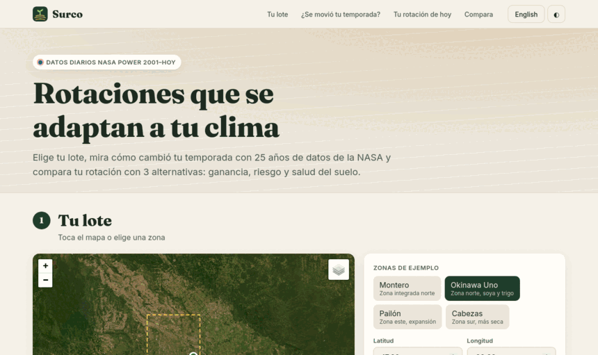

<sub>Elegir el lote → ver cómo cambió la temporada → elegir tu rotación → <b>comparar con 3 alternativas</b> en cada campaña real desde 2001</sub>

</div>


## 🌱 Qué es

En Santa Cruz las lluvias ya no llegan cuando llegaban, hay más días de calor y muchos lotes repiten soya todo el año.
**Surco** le responde a un productor una pregunta concreta: **¿qué rotación me conviene ahora que el clima de mi lote cambió?**

Tocas tu lote en el mapa y Surco descarga **25 años de datos diarios de NASA POWER** para ese punto. Con eso te muestra
cómo se movió tu temporada y **simula tu rotación y más de 4.700 alternativas con el clima real de cada campaña desde 2001**.
Al final te recomienda 3 opciones y te explica, en palabras simples, qué ganas y qué arriesgas con cada una.

<div align="center">
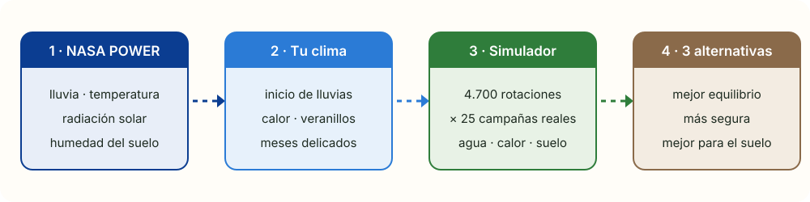
</div>

## 🧭 Cómo se usa

<table>
<tr>
<td align="center" width="50%">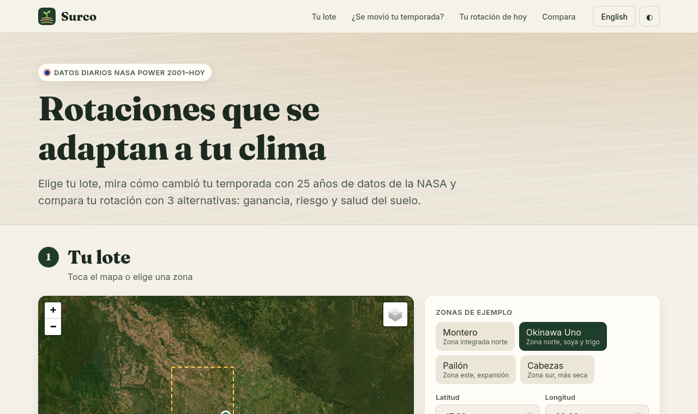<br><b>1 · TU LOTE</b><br><sub>Mapa satelital o 4 zonas de ejemplo. Suelo y agua (secano o riego).</sub></td>
<td align="center" width="50%">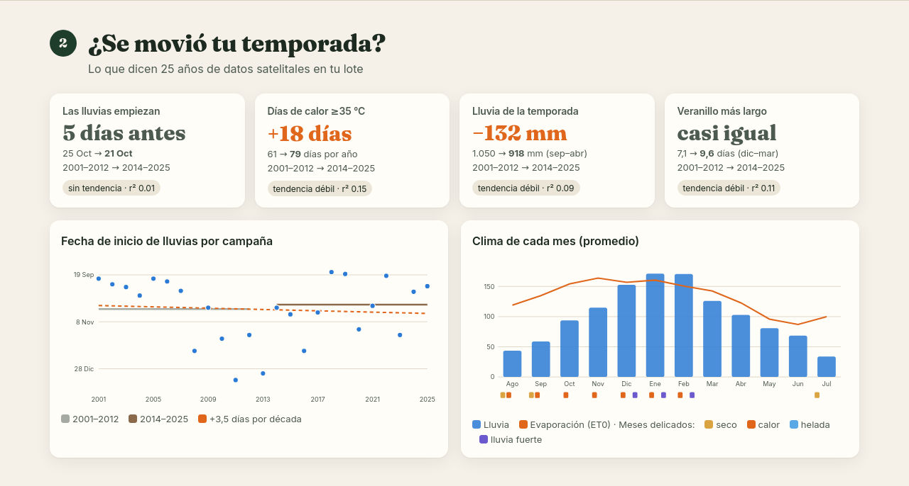<br><b>2 · ¿SE MOVIÓ TU TEMPORADA?</b><br><sub>Inicio de lluvias, calor, lluvia de la temporada y veranillos, con su tendencia.</sub></td>
</tr>
<tr>
<td align="center" width="50%">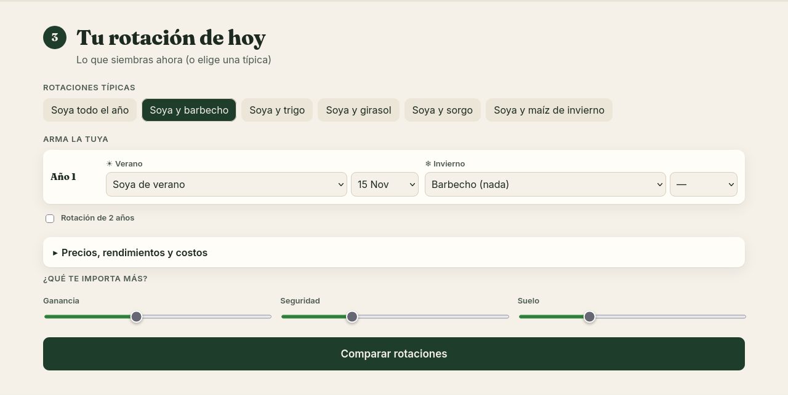<br><b>3 · TU ROTACIÓN</b><br><sub>Una típica o la tuya, de 1 o 2 años, con coberturas. Precios editables.</sub></td>
<td align="center" width="50%">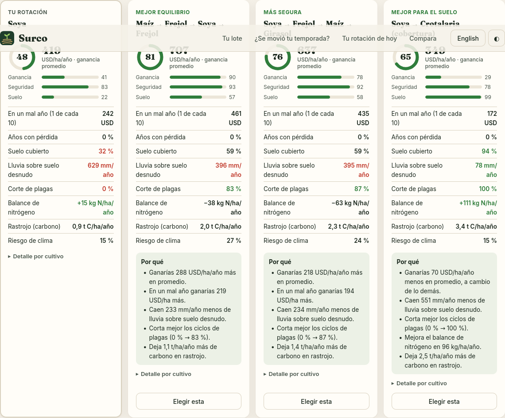<br><b>4 · COMPARA</b><br><sub>Tu rotación contra la de mejor equilibrio, la más segura y la mejor para el suelo.</sub></td>
</tr>
</table>

## 📊 Lo que te muestra

| | |
|---|---|
| 🌧️ **Tu temporada, año por año** | Cuándo empiezan y terminan las lluvias, días de más de 35 °C, lluvia de septiembre a abril y veranillo más largo. Compara 2001–2012 con 2014–2025 y dice si la tendencia es **clara** o **puede ser azar** (r²). |
| 📅 **Meses delicados** | Marca los meses secos, de calor, de helada y de lluvia fuerte, y los pone encima del calendario de cada rotación. |
| 💵 **Ganancia y riesgo** | Ganancia promedio, ganancia **en un mal año** (1 de cada 10) y cuántos años habrías perdido plata. |
| 🟥 **Suelo desnudo** | Cuántos días queda el lote sin cultivo ni rastrojo, y **cuántos mm de lluvia le caen encima** (erosión). |
| 🐛 **Ciclos de plagas** | Si los cultivos seguidos comparten plagas y enfermedades, y si hay **“puente verde”** de soya para la roya asiática y las chinches. |
| 🌿 **Salud del suelo** | Balance de nitrógeno y carbono que vuelve al suelo con el rastrojo. Las coberturas (crotalaria, mijo, braquiaria) cuentan. |
| 🧾 **Por qué** | Cada alternativa explica, en frases cortas, qué cambia frente a tu rotación. |
| 🗓️ **Historial** | Cómo le habría ido a cada rotación en cada campaña real desde 2001/02. |
| 📄 **Informe** | PDF para imprimir y enlace para compartir tu lote y tu rotación. |

<table>
<tr>
<td width="62%">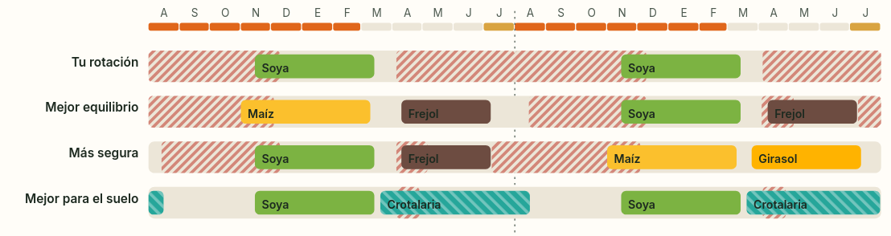<br>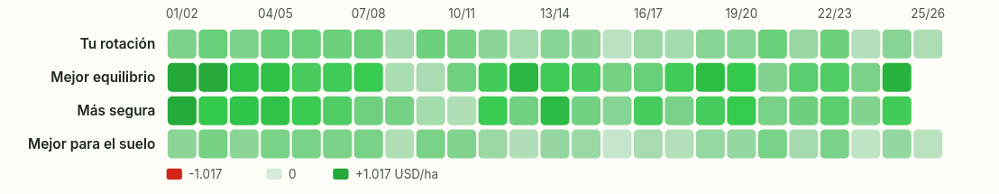</td>
<td width="38%">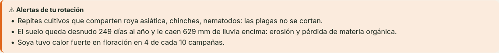<br><sub>Alertas de tu rotación: plagas que no se cortan, suelo desnudo, sequía y calor en floración.</sub></td>
</tr>
</table>

## ✅ Cómo responde al reto Field Shift

| Lo que se busca | Dónde está en Surco |
|---|---|
| Usar datos de observación de la Tierra de la NASA | 6 variables diarias de **NASA POWER** (lluvia, temperaturas, radiación, humedad del suelo superficial y de raíces) para cualquier punto del mapa |
| Comparar **al menos 3 estrategias, incluida la actual** | Siempre muestra tu rotación + 3 alternativas, elegidas entre más de 4.700 |
| Períodos de **campo desnudo** | Días sin cobertura por año, en rojo sobre el calendario, y lluvia que cae sobre ese suelo |
| **Estaciones vulnerables** | Meses secos, de calor, de helada y de lluvia fuerte, sacados de 25 años de datos |
| **Cortar ciclos de plagas** | Similitud de plagas entre cultivos seguidos y alerta de puente verde de la soya |
| Clima que **cambia** | Tendencias de inicio de lluvias, calor y lluvia; cada rotación se prueba en los años malos reales |
| Que lo use un **productor** | Español e inglés, celular, sin instalar nada, sin internet con los datos guardados, explicaciones en palabras simples |

<div align="center">
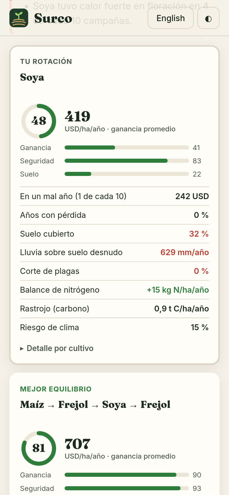&nbsp;&nbsp;&nbsp;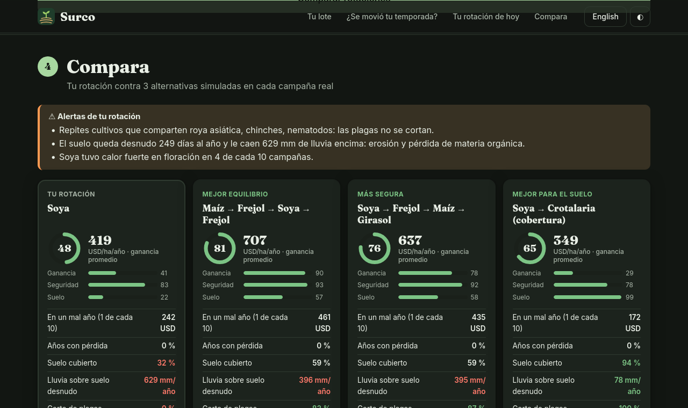
<br><sub>También en el celular y en modo oscuro</sub>
</div>


## 🛰️ Datos de la NASA

| Variable | Parámetro NASA POWER | Para qué la usa Surco |
|---|---|---|
| Lluvia diaria corregida | `PRECTOTCORR` | Inicio y fin de lluvias, veranillos, balance de agua del cultivo, lluvia sobre suelo desnudo |
| Temperatura máxima a 2 m | `T2M_MAX` | Calor en floración, ET0 |
| Temperatura mínima a 2 m | `T2M_MIN` | Heladas, ET0 |
| Radiación solar en superficie | `ALLSKY_SFC_SW_DWN` | Evaporación de referencia (ET0) |
| Humedad del suelo superficial | `GWETTOP` | Si el suelo está listo para sembrar ese día |
| Humedad del suelo en raíces | `GWETROOT` | Agua que el cultivo tiene al sembrar |

[NASA POWER](https://power.larc.nasa.gov/) (NASA Langley), API diaria, comunidad agrícola (AG), 2001 a la fecha, ~0,5°.
La humedad del suelo viene del reanálisis [MERRA-2](https://gmao.gsfc.nasa.gov/reanalysis/MERRA-2/) de NASA GMAO.
La app pide los datos en vivo. Las 4 zonas de ejemplo (Montero, Okinawa Uno, Pailón y Cabezas) también vienen guardadas
en `data/demo/` para presentar sin internet.

## 🧮 El modelo

1. **Evaporación (ET0):** Hargreaves con la radiación solar medida por la NASA.
2. **Agua del cultivo:** coeficientes Kc por etapa ([FAO-56](https://www.fao.org/4/x0490e/x0490e00.htm)) y balance diario del agua en la zona de raíces. El agua disponible depende del suelo: arenoso, franco o arcilloso.
3. **Siembra:** si el suelo superficial está seco, la siembra espera hasta 25 días a que llueva. Si se atrasa, el cultivo siguiente también.
4. **Rendimiento:** respuesta al agua de [FAO-33/66](https://www.fao.org/4/i2800e/i2800e00.htm) (Ky), con más peso en floración. Castiga el calor en floración y las heladas.
5. **Suelo:** cobertura de cada día (cultivo vivo + rastrojo que se descompone), lluvia sobre suelo desnudo, carbono del rastrojo, balance de nitrógeno y plagas compartidas entre cultivos seguidos.
6. **Recomendación:** puntaje de ganancia, seguridad y suelo (tú eliges cuánto pesa cada uno) y 3 alternativas distintas entre sí.

**Calibración:** el rendimiento sin estrés de cada cultivo se ajustó para que el promedio simulado 2001–2024 en Montero, Okinawa y Pailón
se parezca al promedio regional (`scripts/calib.mjs`).

### ⚠️ Límites (léelos)

- Una celda de NASA POWER mide unos 50 km. No ve las diferencias dentro de tu campo.
- El modelo no incluye fertilización, variedades, plagas reales ni manejo. Sirve para **comparar opciones**, no para predecir tu cosecha exacta.
- Precios, costos y rendimientos son valores de referencia para Santa Cruz. Se cambian en la app.
- Una tendencia débil puede ser azar: por eso cada dato del clima muestra su r².


## 🧰 Herramientas, datos y uso de IA

Space Apps pide documentar el software y los servicios de terceros. Surco usa:

| Qué | Para qué | Licencia / nota |
|---|---|---|
| [NASA POWER](https://power.larc.nasa.gov/) API diaria | Clima y humedad del suelo de cada lote | Datos abiertos de NASA |
| [Leaflet](https://leafletjs.com/) 1.9.4 (desde cdnjs) | Mapa | BSD-2 |
| Imágenes satelitales [Esri World Imagery](https://www.arcgis.com/home/item.html?id=10df2279f9684e4a9f6a7f08febac2a9) y [OpenStreetMap](https://www.openstreetmap.org/copyright) | Fondo del mapa | Con atribución en el mapa |
| Fuentes [Fraunces](https://fonts.google.com/specimen/Fraunces) e [Inter](https://fonts.google.com/specimen/Inter) | Letra | SIL Open Font License |
| [esbuild](https://esbuild.github.io/) (vía `npx`) | Armar `Surco.html` | MIT; solo en desarrollo |
| FAO-56 y FAO-33/66 | Coeficientes de cultivo y respuesta al agua | Publicaciones de la FAO |
| Claude (Anthropic) | Asistente de IA usado para programar y redactar | Las decisiones y la revisión son del equipo |

## ▶️ Usar

**En línea:** https://neckhurtttt.github.io/Surco/

**Descargado, sin instalar nada:**

1. Baja `Surco.html` desde [Releases](https://github.com/NeckHurtttt/Surco/releases/latest).
2. Ábrelo con doble clic. Sin internet funciona con las 4 zonas de ejemplo; con internet, con cualquier punto del mapa.

**Para programar:** no hay que compilar nada (HTML, CSS y JavaScript con módulos).

```sh
python3 -m http.server 8000   # http://localhost:8000
npm run build                 # arma dist/Surco.html (un solo archivo)
npm run demo-data             # vuelve a bajar los datos de ejemplo de NASA POWER
```

## 🧪 Pruebas

```sh
npm test                      # 23 pruebas del motor (Node 20+)
node scripts/calib.mjs        # rendimiento simulado promedio de cada cultivo
node scripts/probe.mjs pailon # diagnóstico de una zona: clima, rotaciones típicas y recomendación
```

## 🗂️ Estructura

- `js/core/power.js`: descarga, limpieza y caché de NASA POWER.
- `js/core/agro.js`: ET0, Kc, balance de agua, siembra, rendimiento, rastrojo.
- `js/core/climate.js`: inicio y fin de lluvias, veranillos, calor, heladas, tendencias, meses delicados.
- `js/core/rotation.js`: calendario de cada rotación, simulación por campaña, suelo, puntajes y alternativas.
- `js/data/crops.js`: 10 cultivos y 3 coberturas de la llanura cruceña, suelos, zonas y rotaciones típicas.
- `js/ui/charts.js`: gráficos SVG. `js/app.js`: la interfaz. `js/i18n.js`: español e inglés.
- `data/demo/`: datos NASA POWER guardados de 4 zonas. `tests/`: pruebas. `scripts/`: herramientas.


<a id="english"></a>
## 🌎 English

**Surco** (Spanish for *furrow*) answers one question for a farmer: **which crop rotation should I use now that my field's climate has changed?**

Pick your field on the map and Surco downloads **25 years of daily NASA POWER data** for that point. It shows how your rainy
season, heat days and dry spells have shifted (with an honest r² for each trend), then **simulates your current rotation and
4,700+ alternatives in every real season since 2001**. It recommends 3 of them (best balance, safest, best for the soil) and
compares them on average and bad-year profit, **bare-field periods** and the rain that falls on them, **vulnerable months**,
**pest-cycle breaks** (including the soybean "green bridge"), nitrogen balance and residue carbon, with a plain-language
explanation, a season-by-season history and a printable report.

- **NASA data:** `PRECTOTCORR`, `T2M_MAX`, `T2M_MIN`, `ALLSKY_SFC_SW_DWN`, `GWETTOP`, `GWETROOT` (NASA POWER daily API, AG community, MERRA-2 based).
- **Model:** Hargreaves ET0 with NASA radiation, FAO-56 crop coefficients and a daily root-zone water balance, rain-dependent sowing, FAO-33 yield response to water, heat and frost penalties, daily soil-cover tracking.
- **Use it:** [online](https://neckhurtttt.github.io/Surco/), or download `Surco.html` from Releases and double-click it (works offline with 4 saved zones). The interface is bilingual.
- **Limits:** a NASA grid cell is ~50 km wide; the model compares options, it does not predict your exact harvest; prices are editable reference values.


<div align="center">


**Hecho por [NeckHurtttt](https://github.com/NeckHurtttt)** · NASA Space Apps Challenge 2026 · Field Shift · Santa Cruz, Bolivia 🇧🇴

<sub>sembrar · rotar · cosechar · repetir</sub>

</div>
